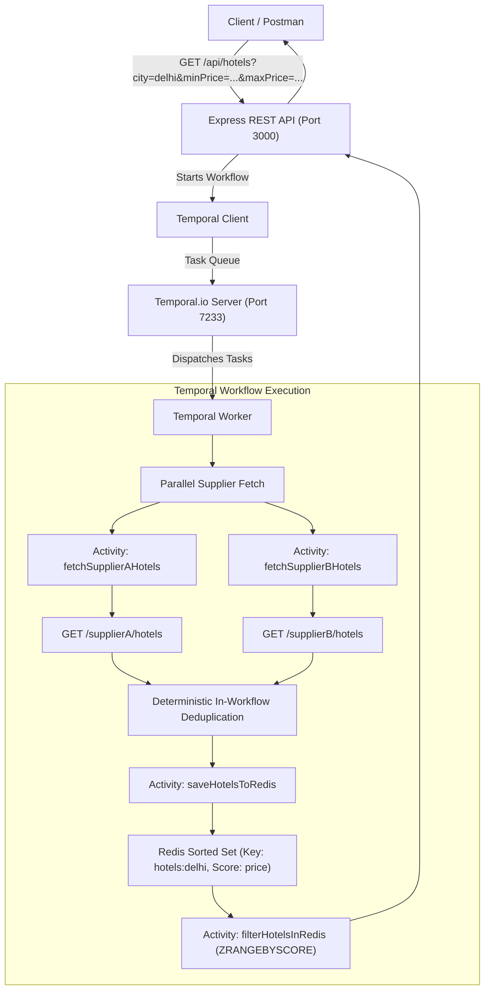

# Hotel Offer Orchestrator

An enterprise-grade hotel offer aggregation and orchestration engine built with **Node.js (TypeScript)**, **Express**, **Temporal.io**, **Redis**, and **Docker Compose**.

This system aggregates hotel listings across multiple independent mock suppliers, deduplicates identical hotels by selecting the best-priced offer, caches the deduplicated results in **Redis Sorted Sets (`ZSET`)**, and executes high-performance price range filtering natively inside Redis.

---

## Architecture & System Design



---

## Tech Stack

| Technology | Purpose |
| :--- | :--- |
| **Node.js & TypeScript** | Strongly typed backend runtime |
| **Express.js** | High-performance REST API layer |
| **Temporal.io** | Distributed workflow orchestration, parallel fan-out, and retry management |
| **Redis (ioredis)** | In-memory Sorted Set storage and in-engine price filtering (`ZRANGEBYSCORE`) |
| **Docker & Docker Compose** | Containerized deployment with zero host dependencies |
| **Jest & Supertest** | Automated unit and integration testing suite |
| **Winston** | Structured JSON & colorized logging |

---

## Key Technical Highlights

### 1. Temporal.io Workflow Orchestration
- **Parallel Execution**: Calls Supplier A and Supplier B simultaneously using `Promise.all` inside the workflow.
- **Deterministic Deduplication**: Evaluates overlapping hotels by normalized name. For identical hotels, it selects the lower price, retaining the winning supplier name and associated commission percentage.
- **Automatic Retries & Resilience**: Activities configured with exponential backoff (`initialInterval: 500ms`, `backoffCoefficient: 2`, `maximumAttempts: 3`).

### 2. Redis Native Price Filtering
- Deduplicated hotel records are persisted into a **Redis Sorted Set (`ZSET`)** with the key `hotels:<city>`.
- The hotel's **price** is used as the ZSET score, while the serialized hotel object is stored as the member.
- When `minPrice` and/or `maxPrice` query parameters are passed, filtering is performed **inside the Redis engine** via `ZRANGEBYSCORE key min max`.
- This avoids pulling unnecessary records into Node.js application memory and leverages Redis's $O(\log N + M)$ skip-list index.

### 3. Comprehensive Health Checks (Bonus Point)
- `GET /health` concurrently inspects:
  - **Supplier A**
  - **Supplier B**
  - **Redis** (latency and `PONG` check)
  - **Temporal.io** (`getSystemInfo` gRPC probe)

---

## API Endpoints

### 1. Aggregated & Deduplicated Hotel Search
- **Endpoint**: `GET /api/hotels?city={cityName}`
- **Query Parameters**:
  - `city` (string, **required**): Name of the city (e.g. `delhi`, `mumbai`, `bengaluru`).
  - `minPrice` (number, optional): Minimum price filter.
  - `maxPrice` (number, optional): Maximum price filter.
  - `allowPartial` (boolean, optional): Set `true` to return available offers even if one supplier is down.
  - `directMode` (boolean, optional): Set `true` to run deduplication directly without Temporal server.

#### Example Request:
```bash
curl -X GET "http://localhost:3000/api/hotels?city=delhi"
```

#### Example Response (matching PDF specification):
```json
[
  {
    "name": "Holtin",
    "price": 5340,
    "supplier": "Supplier B",
    "commissionPct": 20
  },
  {
    "name": "Radison",
    "price": 5900,
    "supplier": "Supplier A",
    "commissionPct": 13
  },
  {
    "name": "Hyatt Regency",
    "price": 8100,
    "supplier": "Supplier B",
    "commissionPct": 14
  },
  {
    "name": "Leela Ambience",
    "price": 8200,
    "supplier": "Supplier B",
    "commissionPct": 16
  },
  {
    "name": "The Imperial",
    "price": 9800,
    "supplier": "Supplier A",
    "commissionPct": 14
  },
  {
    "name": "Taj Palace",
    "price": 11000,
    "supplier": "Supplier A",
    "commissionPct": 15
  },
  {
    "name": "The Oberoi",
    "price": 13800,
    "supplier": "Supplier B",
    "commissionPct": 18
  }
]
```

---

### 2. Price Range Filtering inside Redis
- **Endpoint**: `GET /api/hotels?city=delhi&minPrice=5000&maxPrice=6000`

#### Example Request:
```bash
curl -X GET "http://localhost:3000/api/hotels?city=delhi&minPrice=5000&maxPrice=6000"
```

#### Example Response:
```json
[
  {
    "name": "Holtin",
    "price": 5340,
    "supplier": "Supplier B",
    "commissionPct": 20
  },
  {
    "name": "Radison",
    "price": 5900,
    "supplier": "Supplier A",
    "commissionPct": 13
  }
]
```

---

### 3. Mock Supplier Endpoints
- **Supplier A**: `GET /supplierA/hotels?city=delhi`
- **Supplier B**: `GET /supplierB/hotels?city=delhi`
- **Simulate Outage**: Append `?simulateDown=true` to test error recovery and resilient behavior.

#### Example Supplier Response:
```json
[
  {
    "hotelId": "a1",
    "name": "Holtin",
    "price": 6000,
    "city": "delhi",
    "commissionPct": 10
  }
]
```

---

### 4. System Health Check Endpoint (Bonus Point)
- **Endpoint**: `GET /health`

#### Example Response:
```json
{
  "status": "UP",
  "timestamp": "2026-11-22T03:00:00.000Z",
  "uptimeSeconds": 142,
  "services": {
    "supplierA": {
      "status": "UP",
      "responseTimeMs": 4
    },
    "supplierB": {
      "status": "UP",
      "responseTimeMs": 3
    },
    "redis": {
      "status": "UP",
      "responseTimeMs": 1
    },
    "temporal": {
      "status": "UP"
    }
  }
}
```

---

## Setup & Deployment Instructions

### Option 1: One-Command Setup with Docker Compose (Recommended)

Make sure Docker Desktop is running, then run:

```bash
# Using Docker Compose v2 (or docker-compose with hyphen):
docker compose up --build
# or: docker-compose up --build
```

This starts:
1. **Hotel Offer Orchestrator App & Worker** on `http://localhost:3000`
2. **Redis** on `localhost:6379`
3. **Temporal Server** on `localhost:7233`
4. **Temporal Web UI** on `http://localhost:8233` (Open in your browser to inspect workflows live!)

To stop the containers:
```bash
docker compose down
```

---

### Option 2: Local Development Setup

If running locally on your workstation without Docker:

1. **Install Dependencies**:
   ```bash
   npm install
   ```

2. **Start Redis**:
   ```bash
   redis-server
   ```

3. **Start Temporal Server**:
   ```bash
   temporal server start-dev
   ```

4. **Start Application in Development Mode**:
   ```bash
   npm run dev
   ```

5. **Run Test Suite**:
   ```bash
   npm test
   ```

---

## Postman Collection

A complete Postman test collection is provided in the repository at:
[`postman/Hotel_Offer_Orchestrator.postman_collection.json`](file:///d:/Documents/Triphoria/postman/Hotel_Offer_Orchestrator.postman_collection.json)

### Included Requests:
1. **1. System Health Check** - Checks health of Supplier A, B, Redis, Temporal.
2. **2. Valid City with Expected Overlaps (Delhi)** - Asserts cheaper price selection (Holtin ₹5,340 from Supplier B; Radison ₹5,900 from Supplier A).
3. **3. Price Range Filtering inside Redis** - Queries with `minPrice=5000&maxPrice=6000` and validates range.
4. **4. City with No Results (Unknown City)** - Verifies empty array handling.
5. **5. Simulate Supplier A Outage** - Verifies 503 response on failure simulation.
6. **6. Resilient Search with Partial Outage** - Verifies graceful degradation (`allowPartial=true`).
7. **7. Mock Supplier A Raw Feed** - Inspects Supplier A schema.
8. **8. Mock Supplier B Raw Feed** - Inspects Supplier B schema.

#### How to import:
1. Open Postman.
2. Click **Import**.
3. Select `postman/Hotel_Offer_Orchestrator.postman_collection.json`.
4. Click **Run Collection** to execute all tests automatically.

---

## Submission Checklist Verification

- [x] **Source code**: Node.js (TypeScript), Express, Temporal SDK, Redis.
- [x] **Two Mock Supplier APIs**: `GET /supplierA/hotels` and `GET /supplierB/hotels`.
- [x] **Temporal Workflow Orchestration**: Parallel fetch, deterministic deduplication, best price selection.
- [x] **Redis Storage**: Deduplicated list saved into Redis.
- [x] **Redis Price Filtering**: Executed inside Redis via Sorted Set (`ZRANGEBYSCORE`).
- [x] **Dockerfile**: Multi-stage production container.
- [x] **Docker Compose**: Orchestrates App, Worker, Redis, Temporal Server, and Temporal Web UI.
- [x] **Postman Collection**: Valid city, overlaps, price filter, empty city, simulated supplier outage.
- [x] **README.md**: Clear architectural diagrams, setup guides, and API documentation.
- [x] **Bonus Points**: `/health` endpoint informing health of both suppliers, Redis, and Temporal + logging & error handling.
